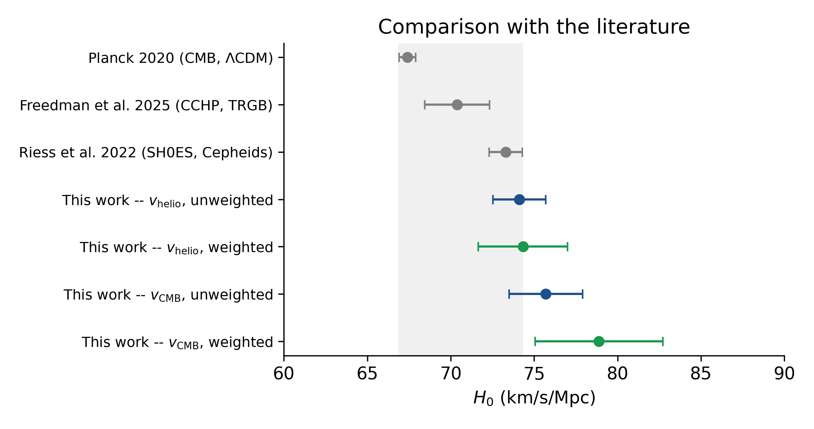

# Estimating the Hubble Constant: From Historical to Modern Data

[](https://doi.org/10.5281/zenodo.22260280)

Independent research project by Alessandro Buttazzo (2026).

**Refitting Hubble's original 1929 data gives H₀ ≈ 424 km/s/Mpc. The same fit on 39 modern galaxies from NED gives H₀ = 68–73 km/s/Mpc**, within the range spanned by Planck (67.4) and SH0ES (73.3).
The fitting method is identical in both cases: the sixfold gap comes from the 1929 distance scale, not from the statistics.
Weighted and errors-in-variables (ODR) fits move the modern estimate by 5–10 km/s/Mpc, so the report treats the choice of method as part of the uncertainty.



*Origin-forced H₀ from the modern sample (blue: unweighted; green: weighted) compared with Planck 2020, Freedman 2021 (TRGB) and Riess et al. 2022 (SH0ES). Hubble's 1929 value, ~424 km/s/Mpc, is far off this scale.*

Full report: [`hubble_report.pdf`](hubble_report.pdf)

## About

This repository reproduces Edwin Hubble's original 1929 measurement of the
Hubble constant $H_0$ and repeats the same statistical analysis on a modern
sample of 39 galaxies drawn from the NASA/IPAC Extragalactic Database (NED),
comparing the two results with current literature values (Planck, SH0ES,
TRGB). The full writeup, with methodology, discussion, and references, is
in [`hubble_report.pdf`](hubble_report.pdf) (source: [`hubble_report.tex`](hubble_report.tex)).

## Repository contents

| File | Description |
|---|---|
| `hubble_report.pdf` / `.tex` | Full report (LaTeX source + compiled PDF) |
| `analysis.py` | Python script that performs all fits, resampling checks, and regenerates the figures |
| `hubble1929.csv` | Hubble's original 1929 dataset (24 objects: distance, velocity) |
| `ned_modern.csv` | Modern sample (39 galaxies) compiled from NED: distance, method, heliocentric and CMB-frame velocity |
| `figures/` | All figures used in the report, as generated by `analysis.py` |
| `analysis_output.txt` | Console output from the latest run of `analysis.py`, kept for reference |
| `requirements.txt` | Exact package versions used to produce the report |
| `CITATION.cff` | Citation metadata (used by GitHub's "Cite this repository" button) |

## Method summary

For each of the two datasets, the script fits Hubble's Law $v = H_0 r$ two
ways (free intercept and forced through the origin), reporting standard
errors and $R^2$. For the modern sample it goes further: the same fits on
the nearby galaxies alone ($r \le 25$ Mpc), to show how the choice of
velocity frame matters when the sample does not reach into the Hubble flow;
an inverse-variance weighted fit (combining representative per-method
distance errors with a peculiar-velocity floor); a jackknife/bootstrap
sensitivity analysis on the five galaxies with geometric maser distances;
and an orthogonal distance regression (ODR) check that allows for
measurement error on distance as well as velocity. See the report for the
full discussion and the reasoning behind each choice.

## Reproducing the analysis

Requirements: **Python 3.11 or newer.** The exact package versions used for
the report are pinned in `requirements.txt`; NumPy 2.4 and pandas 3.0 do not
install on Python 3.10 or older.

```bash
pip install -r requirements.txt
python analysis.py
```

A virtual environment is recommended (`python3 -m venv .venv && source .venv/bin/activate`
before the install).

This prints all fit results (matching the numbers quoted in the report; a
copy is in `analysis_output.txt`) and regenerates the four PNG figures in
`figures/`.

**Note on `scipy.odr`.** The ODR check uses `scipy.odr`, which SciPy
deprecated in version 1.17 and will remove in 1.19. With the pinned
`scipy==1.17.1` it works and only prints a `DeprecationWarning` (the first
two lines of `analysis_output.txt`). With SciPy 1.19 or later, `analysis.py`
will fail at import, so install the pinned versions from `requirements.txt`.
SciPy recommends the standalone [`odrpack`](https://pypi.org/project/odrpack/)
package as the replacement.

## Data sources

- Hubble's 1929 dataset is transcribed from Hubble, E. (1929), *A relation
  between distance and radial velocity among extra-galactic nebulae*, PNAS,
  15(3), 168-173.
- The modern sample is compiled from the NASA/IPAC Extragalactic Database
  (NED), operated by JPL/Caltech under contract with NASA
  (https://ned.ipac.caltech.edu). See Appendix A of the report for query
  details and how to independently retrieve the same entries.

## License

- Code (`analysis.py`) is released under the MIT License — see
  [`LICENSE`](LICENSE).
- The report text and figures are not covered by the MIT license; please
  contact the author before reusing them.

## Citation

If you use this code or data, please cite this repository via its Zenodo
DOI: [10.5281/zenodo.22260280](https://doi.org/10.5281/zenodo.22260280), in
addition to the original data sources listed above. This DOI covers all
archived versions and always resolves to the latest one; each release also
has its own version-specific DOI, listed on the Zenodo page.
