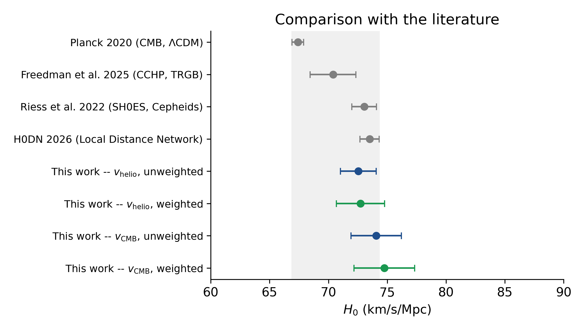

# Estimating the Hubble Constant: From Historical to Modern Data

[](https://doi.org/10.5281/zenodo.22260280)
[](https://github.com/Viserion137/hubble-constant-project/actions/workflows/test.yml)

Independent research project by Alessandro Buttazzo (2026).

**Refitting Hubble's original 1929 data with his own model (expansion plus the motion of the Sun) reproduces his published K = 465 km/s/Mpc. The same kind of fit on 39 modern galaxies gives H₀ = 72.5 ± 1.5 km/s/Mpc** (heliocentric velocities, fit through the origin; 70.0–74.1 for the four unweighted fits), between the CCHP (70.4) and SH0ES (73.0) values and 3.5σ above Planck (67.4).
The fitting method is the same in both cases: the sixfold gap comes from the 1929 distance scale, not from the statistics.
Weighted and errors-in-variables (ODR) fits move the modern estimate within 69.6–74.9 km/s/Mpc, but a paired bootstrap shows these shifts are comparable to each estimator's own sampling noise (at most 1.6σ).



*Origin-forced H₀ from the modern sample (blue: unweighted; green: weighted) compared with Planck 2020, Freedman et al. 2025 (CCHP, TRGB), Riess et al. 2022 (SH0ES) and the H0DN Local Distance Network (2026). Hubble's 1929 value is far off this scale.*

### What changed in v1.3.0

- **Distances and redshifts on the same footing.** The maser distances are angular-diameter distances, the others luminosity distances; the linear Hubble law holds exactly for the comoving distance. All distances are now converted to comoving distance and all velocities to H₀·D_C (flat ΛCDM, Ω_m = 0.315, as in Pesce et al. 2020). This lowers the maser v/r by 1.4–4.1% and the origin-forced estimates by about 2.1 km/s/Mpc, and brings the validation on the published maser result from +0.36σ to −0.18σ.
- **Hubble's own model.** Part 1 now also fits v = K r + X cos α cos δ + Y sin α cos δ + Z sin δ, as Hubble did, and recovers his K = 465 km/s/Mpc, his solar motion and his 150 km/s mean residual.
- **Peculiar-velocity floor from the data.** The weighted fits use σ_pec = 368 km/s (heliocentric) and 528 km/s (CMB frame), the values for which χ²/dof = 1 (maximum likelihood gives 372 and 529), instead of a fixed 200 km/s.
- **Maser velocities** are now the systemic velocities of Pesce et al. (2020), the same ones used in the validation.
- Also: M31 and M81 in the Galactocentric frame, Monte Carlo check of the estimators, SH0ES baseline value (73.04 ± 1.04) and the H0DN 2026 result, ODR without the deprecated `scipy.odr`, unit tests, and a CI check that the output matches `analysis_output.txt`.

Earlier changes are listed in [`CHANGELOG.md`](CHANGELOG.md).

Full report: [`hubble_report.pdf`](hubble_report.pdf)

## About

This repository reproduces Edwin Hubble's original 1929 measurement of the
Hubble constant $H_0$ and repeats the same statistical analysis on a modern
sample of 39 galaxies drawn from the NASA/IPAC Extragalactic Database (NED),
comparing the two results with current literature values (Planck, CCHP,
SH0ES, H0DN). The full writeup, with methodology, discussion, and references,
is in [`hubble_report.pdf`](hubble_report.pdf) (source: [`hubble_report.tex`](hubble_report.tex)).

## Repository contents

| File | Description |
|---|---|
| `hubble_report.pdf` / `.tex` | Full report (LaTeX source + compiled PDF) |
| `analysis.py` | Runs every fit, check and figure of the report |
| `hubble_fits.py` | The fitting and conversion functions used by `analysis.py` |
| `tests/` | Unit tests of those functions on synthetic data (`pytest`) |
| `hubble1929.csv` | Hubble's 1929 dataset (24 objects: distance, velocity), with J2000 coordinates |
| `ned_modern.csv` | Modern sample (39 galaxies): distance, method, heliocentric and CMB-frame velocity, velocity source |
| `mcp_pesce2020.csv` | Distances, uncertainties and CMB-frame velocities of the six maser galaxies from Table 1 of Pesce et al. (2020) |
| `figures/` | All figures used in the report, as generated by `analysis.py` |
| `analysis_output.txt` | Console output of `analysis.py`; the CI checks that a fresh run reproduces it exactly |
| `requirements.txt` | Exact package versions used to produce the report |
| `CITATION.cff` | Citation metadata (used by GitHub's "Cite this repository" button) |

## Method summary

For Hubble's data the script fits $v = H_0 r$ (free intercept and through the
origin) and Hubble's own model with the solar motion. For the modern sample it
first converts every distance to comoving distance and every velocity to
$H_0 D_C$, then runs: the same two fits in both velocity frames; the nearby
galaxies alone ($r \le 25$ Mpc); jackknife and bootstrap checks of the six
maser galaxies; weighted fits (per-method distance errors plus a
peculiar-velocity floor estimated from the data); an orthogonal distance
regression; a Monte Carlo check of the estimators; a paired bootstrap of the
ten estimators; and a validation against the published Megamaser Cosmology
Project result. See the report for the reasoning behind each choice.

## Reproducing the analysis

Requirements: **Python 3.11 or newer.** The exact package versions used for
the report are pinned in `requirements.txt`; NumPy 2.4 and pandas 3.0 do not
install on Python 3.10 or older.

```bash
pip install -r requirements.txt
python analysis.py            # about 20 seconds
pip install pytest && pytest  # optional: unit tests
```

A virtual environment is recommended (`python3 -m venv .venv && source .venv/bin/activate`
before the install).

This prints all fit results (matching the numbers quoted in the report and
`analysis_output.txt`) and regenerates the four PNG figures in `figures/`.

## Data sources

- Hubble's 1929 dataset is transcribed from Hubble, E. (1929), *A relation
  between distance and radial velocity among extra-galactic nebulae*, PNAS,
  15(3), 168-173. Coordinates: OpenNGC catalogue for the NGC objects,
  SIMBAD for the Magellanic Clouds.
- The modern sample is compiled from the NASA/IPAC Extragalactic Database
  (NED), operated by JPL/Caltech under contract with NASA
  (https://ned.ipac.caltech.edu). See Appendix A of the report for query
  details and how to independently retrieve the same entries.
- The maser distances and velocities are from Reid, Pesce & Riess (2019),
  ApJL 886, L27 (NGC 4258) and Pesce et al. (2020), *The Megamaser Cosmology
  Project. XIII. Combined Hubble constant constraints*, ApJL 891, L1.

## License

- Code (`analysis.py`, `hubble_fits.py`, `tests/`) is released under the MIT License — see
  [`LICENSE`](LICENSE).
- The report text and figures are not covered by the MIT license; please
  contact the author before reusing them.

## Citation

If you use this code or data, please cite this repository via its Zenodo
DOI: [10.5281/zenodo.22260280](https://doi.org/10.5281/zenodo.22260280), in
addition to the original data sources listed above. This DOI covers all
archived versions; each release also has its own version-specific DOI,
listed on the Zenodo page.
